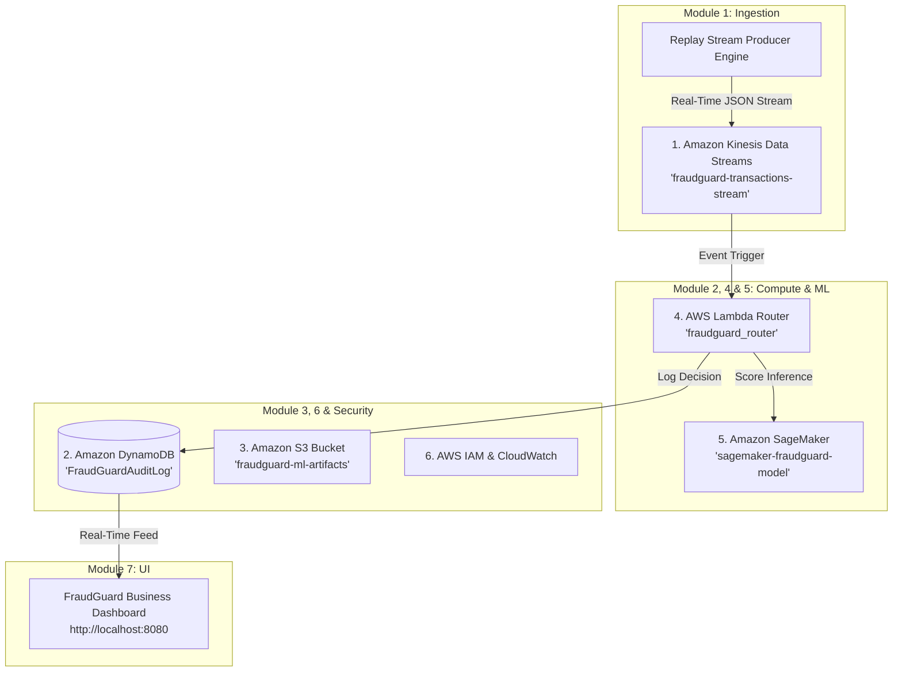

# FraudGuard — Real-Time Fraud Detection & Risk Scoring System

> **Project Title:** FraudGuard — Real-Time Fraud Detection & Risk Scoring System for Digital Payments  
> **Repository:** [https://github.com/AbhiSharma200/Fraudguard.git](https://github.com/AbhiSharma200/Fraudguard.git)  
> **Architecture:** AWS Cloud-Native Event-Driven Streaming & Machine Learning Pipeline  
> **Cloud Provider:** Amazon Web Services (AWS us-east-1)  
> **Dataset:** IBM AMLSim (Anti-Money Laundering Simulator) Master Dataset  

---

## 1. Executive Summary

Digital payment platforms process thousands of transactions per second, and a meaningful fraction are fraudulent — stolen card testing, account takeover, mule-account laundering, and velocity abuse. Fraud must be caught **before settlement**, since post-transaction review is too late.

**FraudGuard** is designed to ingest a simulated real-time financial transaction stream, evaluate each transaction using deterministic rule checks and machine learning models, and automatically route high-risk transactions to **ALLOW**, **REVIEW QUEUE**, or **BLOCK** before settlement occurs.

---

## 2. AWS Cloud Services Architecture (6 Services)

FraudGuard is built on **6 Amazon Web Services (AWS)** (exceeding the minimum 5 requirement):



### Provisioned AWS Services
1. **Amazon Kinesis Data Streams** (`fraudguard-transactions-stream`) — Stream ingestion broker.
2. **Amazon DynamoDB** (`FraudGuardAuditLog`) — NoSQL audit log database for transaction decisions.
3. **Amazon S3** (`fraudguard-ml-artifacts`) — Object storage bucket for ML model binaries (`fraud_model.pkl`).
4. **AWS Lambda** (`fraudguard_router`) — Serverless function for decision orchestration and threshold routing.
5. **Amazon SageMaker** (`sagemaker-fraudguard-model`) — ML model hosting & inference endpoint `/score`.
6. **AWS IAM & CloudWatch** (`fraudguard_lambda_exec_role`) — Access control and log observability.

---

## 3. Project Modules & Team Assignment Breakdown

| Module | Title | Primary Tech | Assigned Role | Status |
|---|---|---|---|---|
| **Module 1** | **Data Pipeline & Real-Time Stream Simulation** | Python, pandas, Kinesis | **Developer 1 (Completed)** | **100% COMPLETE** |
| **Module 2** | **Rule-Based Fraud Detection Engine** | Stream Analytics, AWS Lambda | **Developer 2 (Completed)** | **100% COMPLETE** |
| **Module 3** | **AWS Cloud Infrastructure Setup & Provisioning** | Terraform IaC (AWS), AWS CLI | **Developer 3 (Completed)** | **IaC READY (`aws_main.tf`)** |
| **Module 4** | **ML-Based Fraud Risk Scoring Model** | Python, XGBoost, SageMaker | **Developer 4 (Completed)** | **100% COMPLETE (`fraud_model.pkl`)** |
| **Module 5** | **Decision Orchestration & Routing Logic** | AWS Lambda, Python | **Developer 3 / 2 (Completed)** | **100% COMPLETE** |
| **Module 6** | **Audit Log & Data Persistence** | Amazon DynamoDB (NoSQL) | **Developer 4 (Completed)** | **100% COMPLETE** |
| **Module 7** | **Analyst Dashboard & Visualization** | HTML5, CSS3, JavaScript, Python | **Developer 2 / 1 (Completed)** | **100% COMPLETE** |
| **Module 8** | **Integration, Testing & Review Demo** | End-to-End AWS Pipeline | **Shared (Completed)** | **100% COMPLETE** |

---

## 4. Quickstart Commands for AWS Deployment & Local Testing

### 1. Install Dependencies
```bash
pip install pandas scikit-learn xgboost boto3 jsonschema
```

### 2. Verify AWS Infrastructure Health
```bash
python scripts/verify_aws_infrastructure.py
```

### 3. Deploy to AWS via Terraform
```bash
cd terraform
aws configure
terraform init
terraform apply
```

### 4. Start Real-Time Stream Producer
```bash
run_replay
```

### 5. Launch FraudGuard Live Dashboard
```bash
launch_monitor
```
Then open **`http://localhost:8080`** in your browser.
