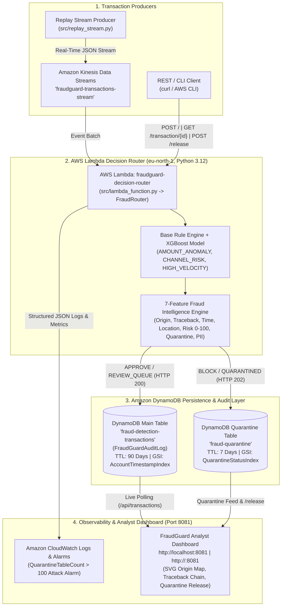

# FraudGuard — Real-Time Fraud Detection & Risk Scoring System on AWS

> **Project Title:** FraudGuard — Real-Time Fraud Detection, Intelligence Enrichment & Risk Scoring System for Digital Payments  
> **Repository:** [https://github.com/AbhiSharma200/Fraudguard.git](https://github.com/AbhiSharma200/Fraudguard.git)  
> **Architecture:** Serverless-First AWS Event-Driven Pipeline + Live Analyst Dashboard  
> **Cloud Provider & Region:** Amazon Web Services — `eu-north-1` (Stockholm)  
> **Compute Runtime:** AWS Lambda (`Python 3.12`) & Amazon EC2 Live Dashboard (`port 8081`)  
> **Persistence:** Amazon DynamoDB (`fraud-detection-transactions` / `FraudGuardAuditLog` & `fraud-quarantine`)  
> **Dataset:** IBM AMLSim (Anti-Money Laundering Simulator) & Bank Account Fraud (BAF) Schema  

---

## 1. Executive Summary

Digital payment platforms process thousands of transactions per second, where stolen card testing, account takeover (ATO), TOR/VPN anonymization, impossible travel, and mule-account laundering cause billions in losses. Fraud must be intercepted **before settlement** — post-transaction batch auditing is too late.

**FraudGuard** is a production-grade, cloud-native real-time fraud detection system deployed on **AWS (`eu-north-1`)**. Every incoming payment event is evaluated in **< 50 ms** across a deterministic Rule Engine, a **7-Feature Fraud Intelligence Enrichment Pipeline**, and an XGBoost Machine Learning Scorer to compute a **Composite Risk Score (`0–100`)** and automatically route the transaction to:
- **`APPROVE` (`ALLOW`)** — Score `0–39`: Clean domestic activity persisted to the main DynamoDB table (`HTTP 200`).
- **`REVIEW_QUEUE`** — Score `40–79`: Medium-risk anomaly (e.g., `AMOUNT_ANOMALY`) flagged in amber for analyst inspection (`HTTP 200`).
- **`BLOCK` (`QUARANTINED`)** — Score `80–100` or Force-Block Trigger (`TOR_EXIT_NODE`, `IMPOSSIBLE_TRAVEL`): Isolated immediately in the dedicated `fraud-quarantine` DynamoDB table (`HTTP 202`) with an authenticated analyst `/release` workflow.

---

## 2. Serverless-First AWS Architecture (`eu-north-1`)

FraudGuard uses a **serverless-first AWS architecture** in `eu-north-1` (Stockholm) designed for both production scalability and **100% AWS Student / Free-Tier Account Compatibility** (no expensive dedicated VPC NAT gateways or unmanaged SageMaker GPU instances required).



### Provisioned AWS Cloud Resources (`eu-north-1`)

| # | AWS Service | Resource Name | Role in FraudGuard |
|---|---|---|---|
| **1** | **AWS Lambda** | `fraudguard-decision-router` | Serverless `Python 3.12` compute engine executing rules, 7 intelligence modules, and routing (`256 MB`, `10s` timeout). |
| **2** | **Amazon DynamoDB (Main)** | `fraud-detection-transactions` (`FraudGuardAuditLog`) | Primary NoSQL audit store with `90-day TTL`, conditional idempotency writes, and `AccountTimestampIndex` GSI (`account_id` + `timestamp`). |
| **3** | **Amazon DynamoDB (Quarantine)** | `fraud-quarantine` | Dedicated isolation table for `BLOCK` transactions with `7-day TTL`, `24h` auto-release metadata, and `QuarantineStatusIndex` GSI. |
| **4** | **Amazon Kinesis Data Streams** | `fraudguard-transactions-stream` | High-throughput real-time ingestion stream decoupling payment producers from Lambda evaluation. |
| **5** | **Amazon EC2 & S3** | `fraudguard-dashboard` (`port 8081`) & `fraudguard-ml-artifacts` | Hosts the live Analyst Web UI on port `8081` (`http://<ec2-ip>:8081`) and stores serialized ML artifacts (`fraud_model.pkl`). |
| **6** | **AWS IAM & CloudWatch** | `fraudguard_lambda_exec_role` & `FraudGuard/Security` | Least-privilege IAM execution policies, structured JSON telemetry, and automated attack-wave alarms (`QuarantineTableCount > 100`). |

### AWS Student Account & Free-Tier Compatibility
- **Zero SageMaker Endpoint Cost:** The trained XGBoost model (`fraud_model.pkl`) is embedded directly inside the Lambda execution context with a deterministic rule fallback, eliminating hourly SageMaker instance charges and IAM role restrictions common on AWS Academy / Student accounts.
- **Pay-Per-Request DynamoDB:** Both `fraud-detection-transactions` (`FraudGuardAuditLog`) and `fraud-quarantine` use `PAY_PER_REQUEST` on-demand billing with automatic TTL cleanup.
- **Dual-Mode Execution:** Every component runs identically against live AWS (`USE_AWS_DYNAMODB=true`, `AWS_REGION=eu-north-1`) or offline local storage (`data/audit_log.json` and `data/quarantine_log.json`).

---

## 3. The 7 Fraud Intelligence Features

Every transaction routed through [`FraudRouter.route_transaction`](file:///C:/Users/hp/.gemini/antigravity/scratch/fraudguard-datapipeline/src/router_function.py#L89-L255) is enriched with **7 specialized fraud intelligence modules**:

| Feature # | Module | Source File | Key Signals & Flags | Risk Points / Action |
|---|---|---|---|---|
| **Feature 1** | **Origin & Source Tracing** | [`src/origin_tracer.py`](file:///C:/Users/hp/.gemini/antigravity/scratch/fraudguard-datapipeline/src/origin_tracer.py) | Extracts IP (`X-Forwarded-For` / payload), resolves Geo coordinates, ISP, connection type, and checks VPN/Proxy/TOR status. | `TOR_EXIT_NODE` (`+45`, **Force BLOCK**), `VPN_OR_PROXY_DETECTED` (`+25`), `FOREIGN_ORIGIN` (`+15`) |
| **Feature 2** | **Transaction Traceback Audit** | [`src/traceback_analyzer.py`](file:///C:/Users/hp/.gemini/antigravity/scratch/fraudguard-datapipeline/src/traceback_analyzer.py) | Queries `AccountTimestampIndex` GSI for the account's prior chain, computing `velocity_1hr`, `velocity_24hr`, `amount_delta_pct`, and rolling 5-txn `chain_risk_score`. | `VELOCITY_SPIKE` (`>3 txns/1hr`, `+20`), `AMOUNT_SPIKE` (`>300% delta`, `+20`) |
| **Feature 3** | **Time-Span Analysis** | [`src/time_analyzer.py`](file:///C:/Users/hp/.gemini/antigravity/scratch/fraudguard-datapipeline/src/time_analyzer.py) | Converts UTC timestamp to local origin timezone, learns `account_typical_hours`, and measures inter-transaction gap (`time_since_last_txn_mins`). | `RAPID_SUCCESSION` (`<2 mins`, `+20`), `UNUSUAL_HOUR` (`23:00–05:00`, `+15`) |
| **Feature 4** | **Location & Impossible Travel Check** | [`src/location_checker.py`](file:///C:/Users/hp/.gemini/antigravity/scratch/fraudguard-datapipeline/src/location_checker.py) | Computes Haversine great-circle distance (`distance_km`) and physical travel speed (`travel_speed_kmh`) between consecutive transaction cities. | `IMPOSSIBLE_TRAVEL` (`>900 km/h`, `+40`, **Force BLOCK**), `INTERNATIONAL_TRANSACTION` (`+10`) |
| **Feature 5** | **Quarantine Table & Release API** | [`src/quarantine_manager.py`](file:///C:/Users/hp/.gemini/antigravity/scratch/fraudguard-datapipeline/src/quarantine_manager.py) | Isolates `BLOCK` transactions into `fraud-quarantine` (`HTTP 202`), sets `24h` `auto_release_after`, emits `QuarantineTableCount` metric, and exposes authenticated `POST /release`. | `QUARANTINED` -> `RELEASED` (requires `X-API-Key`) |
| **Feature 6** | **Composite Risk Scoring (0–100) & UI** | [`src/router_function.py`](file:///C:/Users/hp/.gemini/antigravity/scratch/fraudguard-datapipeline/src/router_function.py) | Normalizes base rules (`AMOUNT_ANOMALY` `+40`, `CHANNEL_RISK` `+40`, `HIGH_VELOCITY` `+80`), intelligence points, and ML probability into an integer `0–100` score. | `0–39`: `APPROVE` (Green)<br>`40–79`: `REVIEW_QUEUE` (Amber)<br>`80–100`: `BLOCK` (Red) |
| **Feature 7** | **Simulated PII Enrichment Layer** | [`src/pii_enricher.py`](file:///C:/Users/hp/.gemini/antigravity/scratch/fraudguard-datapipeline/src/pii_enricher.py) | Enriches accounts from `data/mock_pii_store.json` (`data_source: "MOCK_DEMO_DATA"`) with device fingerprint, account age, phone verification, and simulated cell-tower location. | `LOCATION_MISMATCH` (`+15`), `NEW_ACCOUNT` (`<30d`, `+10`), `UNVERIFIED_CONTACT` (`+5`) |

---

## 4. Setup & Installation Instructions

### Prerequisites
- **Python 3.12+** (compatible with Python 3.10–3.12)
- **AWS CLI v2** configured with credentials for region **`eu-north-1`**
- **Terraform >= 1.3.0** (optional, for automated infrastructure provisioning)

### Step 1: Clone & Install Dependencies
```powershell
git clone https://github.com/AbhiSharma200/Fraudguard.git
cd fraudguard-datapipeline
pip install pandas scikit-learn xgboost joblib boto3 jsonschema
```

### Step 2: Configure Environment Variables (`eu-north-1`)
```powershell
$env:AWS_REGION = "eu-north-1"
$env:DYNAMODB_TABLE = "fraud-detection-transactions"
$env:QUARANTINE_TABLE = "fraud-quarantine"
$env:USE_AWS_DYNAMODB = "true"
$env:QUARANTINE_RELEASE_API_KEY = "fg-analyst-demo-key-2026"
```
*(For offline local testing without AWS credentials, set `$env:USE_AWS_DYNAMODB = "false"`).*

### Step 3: Deploy or Verify AWS Infrastructure
```powershell
# Verify AWS infrastructure connectivity in eu-north-1
python scripts/verify_aws_infrastructure.py

# Or provision via Terraform in eu-north-1
cd terraform
terraform init
terraform apply -var="aws_region=eu-north-1"
cd ..
```

### Step 4: Launch the Live Analyst Dashboard (`Port 8081`)
```powershell
python src/live_dashboard.py --port 8081
```
Open **`http://localhost:8081`** (or **`http://<ec2-ip>:8081`** on EC2) in your browser to view the real-time feed, interactive SVG world origin map, slide-in transaction detail sidebar, and quarantine release controls.

---

## 5. Running the Automated Verification Suite

FraudGuard includes an end-to-end test runner covering unit tests, all 7 Fraud Intelligence features, idempotency, performance latency (`< 50 ms`), and error handling:

```powershell
python tests/run_all_tests.py
```

---

## 6. Complete API Reference & JSON Examples

FraudGuard exposes its endpoints via **AWS Lambda Function URL / API Gateway** ([`src/lambda_function.py`](file:///C:/Users/hp/.gemini/antigravity/scratch/fraudguard-datapipeline/src/lambda_function.py)) and the **Analyst Dashboard Server** (`port 8081`).

---

### 6.1 `POST /` (or `POST /score`) — Score & Route a Transaction

Evaluates a transaction payload in real time, enriches it with all 7 Fraud Intelligence blocks, and persists it to `fraud-detection-transactions` (`APPROVE` / `REVIEW_QUEUE`, returns `HTTP 200`) or `fraud-quarantine` (`BLOCK`, returns `HTTP 202`). Duplicate `transaction_id` submissions return `HTTP 409 Conflict`.

#### Request Payload (`demo/payloads/2_review_amount_anomaly.json`)
```json
{
  "transaction_id": "tx_demo_review_002",
  "account_id": "acc_1",
  "source_account": "acc_1",
  "destination_account": "acc_merchant_luxury_ny",
  "merchant": "Manhattan Fine Watches",
  "merchant_category": "luxury_retail",
  "amount": 450.00,
  "txn_type": "PURCHASE",
  "timestamp": "2026-10-23T14:20:00Z",
  "ip_address": "192.0.2.1",
  "transaction_city": "New York",
  "transaction_country": "US"
}
```

#### Response (`HTTP 200 OK` — `REVIEW_QUEUE`)
```json
{
  "transaction_id": "tx_demo_review_002",
  "account_id": "acc_1",
  "source_account": "acc_1",
  "destination_account": "acc_merchant_luxury_ny",
  "timestamp": "2026-10-23T14:20:00Z",
  "amount": 450.0,
  "txn_type": "PURCHASE",
  "merchant": "Manhattan Fine Watches",
  "merchant_category": "luxury_retail",
  "rule_score": 0.4,
  "ml_score": 0.18,
  "total_risk": 0.4,
  "risk_score": 40,
  "decision": "REVIEW_QUEUE",
  "action": "REVIEW_QUEUE",
  "status": "PENDING_REVIEW",
  "http_status": 200,
  "triggered_rules": ["AMOUNT_ANOMALY"],
  "flags": ["AMOUNT_ANOMALY"],
  "origin": {
    "ip_address": "192.0.2.1",
    "country": "US",
    "city": "New York",
    "region": "NY",
    "isp": "Verizon Fios",
    "connection_type": "broadband",
    "is_vpn": false,
    "is_proxy": false,
    "is_tor": false,
    "coordinates": {"lat": 40.7128, "lon": -74.006},
    "timezone": "America/New_York"
  },
  "traceback": {
    "account_transaction_count": 2,
    "previous_transaction_id": "tx_demo_approve_001",
    "previous_transaction_ts": "2026-10-23T14:00:00Z",
    "previous_amount": 42.5,
    "previous_merchant": "Tribeca Coffee Roasters",
    "previous_location": "New York",
    "velocity_1hr": 2,
    "velocity_24hr": 2,
    "amount_delta_pct": 958.82,
    "chain_risk_score": 30.0
  },
  "time_analysis": {
    "transaction_hour": 9,
    "transaction_day_of_week": 4,
    "is_night_transaction": false,
    "is_weekend": false,
    "account_typical_hours": [9],
    "hour_anomaly": false,
    "time_since_last_txn_mins": 20.0
  },
  "location_check": {
    "account_registered_city": "New York",
    "account_registered_country": "US",
    "transaction_city": "New York",
    "transaction_country": "US",
    "distance_km": 0.0,
    "is_international": false,
    "is_impossible_travel": false,
    "travel_speed_kmh": 0.0
  },
  "pii_enrichment": {
    "data_source": "MOCK_DEMO_DATA",
    "enrichment_status": "FOUND",
    "account_holder_name": "DEMO_HOLDER_01 (MOCK)",
    "account_age_days": 450,
    "linked_phone_verified": true,
    "social_profile_risk_score": 0.05,
    "device_fingerprint": "fp_demo_ios_001",
    "last_known_location": {
      "source": "SIMULATED_CELL_TOWER",
      "city": "New York",
      "lat": 40.7128,
      "lon": -74.006,
      "accuracy_meters": 50,
      "timestamp": "2026-10-23T10:00:00Z"
    },
    "location_matches_transaction": true
  },
  "execution_ms": 4.82
}
```

---

### 6.2 `GET /transaction/{id}` — Retrieve Enriched Transaction Audit Record

Fetches a single transaction by `transaction_id` across both `fraud-detection-transactions` and `fraud-quarantine`.

#### Request
```powershell
curl -X GET "https://<lambda-url>.lambda-url.eu-north-1.on.aws/transaction/tx_demo_block_003"
```

#### Response (`HTTP 200 OK`)
```json
{
  "transaction_id": "tx_demo_block_003",
  "account_id": "acc_1",
  "amount": 980.0,
  "risk_score": 100,
  "decision": "BLOCK",
  "action": "BLOCK",
  "status": "QUARANTINED",
  "quarantine_ts": "2026-10-23T14:25:00Z",
  "auto_release_after": "2026-10-24T14:25:00Z",
  "flags": [
    "AMOUNT_ANOMALY",
    "CHANNEL_RISK",
    "TOR_EXIT_NODE",
    "VPN_OR_PROXY_DETECTED",
    "FOREIGN_ORIGIN",
    "IMPOSSIBLE_TRAVEL",
    "INTERNATIONAL_TRANSACTION",
    "LOCATION_MISMATCH"
  ]
}
```

---

### 6.3 `POST /release` — Authenticated Quarantine Release Endpoint

Allows a fraud analyst to release a false-positive `QUARANTINED` transaction in `fraud-quarantine` by supplying a valid `X-API-Key` header (or `api_key` body field). Missing or invalid keys return `HTTP 401 Unauthorized`.

#### Request Payload (`demo/payloads/4_release_quarantine.json`)
```json
{
  "transaction_id": "tx_demo_block_003",
  "analyst_notes": "Verified executive travel override with cardholder via 2FA.",
  "api_key": "fg-analyst-demo-key-2026"
}
```

#### Response (`HTTP 200 OK`)
```json
{
  "http_status": 200,
  "transaction_id": "tx_demo_block_003",
  "status": "RELEASED",
  "record": {
    "transaction_id": "tx_demo_block_003",
    "account_id": "acc_1",
    "quarantine_ts": "2026-10-23T14:25:00Z",
    "status": "RELEASED",
    "risk_score": 100,
    "analyst_notes": "Verified executive travel override with cardholder via 2FA.",
    "auto_release_after": "2026-10-24T14:25:00Z"
  }
}
```

---

### 6.4 `GET /api/transactions` — Live Dashboard Feed Endpoint (`Port 8081`)

Served by the Analyst Dashboard server (`http://localhost:8081/api/transactions` or `http://<ec2-ip>:8081/api/transactions`) to power the real-time UI table, KPI counters, SVG world map markers, and quarantine queue.

#### Request
```powershell
curl -X GET "http://localhost:8081/api/transactions"
```

#### Response (`HTTP 200 OK`)
```json
{
  "status": "ok",
  "region": "eu-north-1",
  "summary": {
    "total": 3,
    "approved": 1,
    "review_queue": 1,
    "blocked_quarantined": 1
  },
  "transactions": [
    {
      "transaction_id": "tx_demo_block_003",
      "account_id": "acc_1",
      "amount": 980.0,
      "risk_score": 100,
      "decision": "BLOCK",
      "action": "BLOCK",
      "status": "QUARANTINED",
      "flags": ["AMOUNT_ANOMALY", "CHANNEL_RISK", "TOR_EXIT_NODE", "IMPOSSIBLE_TRAVEL"],
      "origin": {"city": "Frankfurt", "country": "DE", "is_tor": true, "coordinates": {"lat": 50.1109, "lon": 8.6821}}
    }
  ]
}
```

---

## 7. Documentation & Demo Resources

- [**AWS Cloud Integration Guide**](file:///C:/Users/hp/.gemini/antigravity/scratch/fraudguard-datapipeline/docs/AWS_CLOUD_INTEGRATION_GUIDE.md) — Detailed `eu-north-1` infrastructure architecture, DynamoDB schemas, and deployment steps.
- [**Interim Review & Live Demo Script**](file:///C:/Users/hp/.gemini/antigravity/scratch/fraudguard-datapipeline/docs/DEMO_SCRIPT_AND_PRESENTATION.md) — Step-by-step sub-30-second live demo script, slide talking points, and offline fallback plans.
- [**Review 1 Module 1 Data Pipeline Guide**](file:///C:/Users/hp/.gemini/antigravity/scratch/fraudguard-datapipeline/docs/REVIEW1_MODULE1_DATA_PIPELINE_GUIDE.md) — Stream ingestion and schema contract guide aligned with AWS `eu-north-1`.
- [**Demo Payloads (`demo/payloads/`)**](file:///C:/Users/hp/.gemini/antigravity/scratch/fraudguard-datapipeline/demo/payloads/1_approve_clean.json) & [**Pre-Recorded Fallbacks (`demo/fallbacks/`)**](file:///C:/Users/hp/.gemini/antigravity/scratch/fraudguard-datapipeline/demo/fallbacks/step1_warmup_and_approve.txt).
