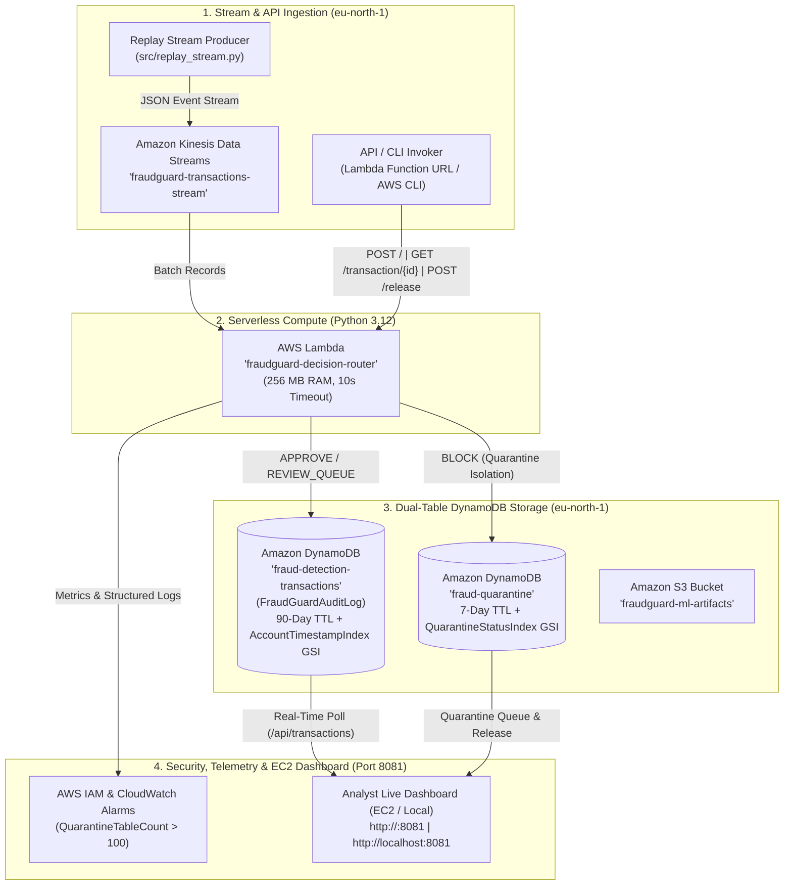

# FraudGuard — AWS Cloud Integration Guide (`eu-north-1`)

> **Project Title:** FraudGuard — Real-Time Fraud Detection & Risk Scoring System  
> **Cloud Provider:** Amazon Web Services (AWS)  
> **Primary Region:** `eu-north-1` (Europe — Stockholm)  
> **Compute Runtime:** AWS Lambda (`Python 3.12`) & Amazon EC2 Dashboard (`Port 8081`)  

---

## 1. AWS Cloud Architecture Overview (`eu-north-1`)

FraudGuard uses a **serverless-first AWS architecture** in **`eu-north-1` (Stockholm)** combining real-time stream ingestion, serverless `Python 3.12` decision orchestration, dual-table Amazon DynamoDB persistence with TTL and Global Secondary Indexes (GSIs), CloudWatch attack-wave alarms, and a live Analyst Dashboard hosted on **port `8081`**.

> [!NOTE]
> **Why Serverless Embedded Scoring Instead of SageMaker Endpoints?**  
> To ensure zero idle hourly billing, sub-15ms inference latency, and 100% compatibility with **AWS Academy / Student accounts**, FraudGuard loads `fraud_model.pkl` directly inside the `Python 3.12` AWS Lambda container alongside the deterministic Rule Engine and 7-Feature Fraud Intelligence pipeline.



---

## 2. Provisioned AWS Cloud Services (`eu-north-1`)

| # | AWS Cloud Service | Resource Identifier | Project Function | Terraform Resource (`terraform/aws_main.tf`) |
|---|---|---|---|---|
| **1** | **AWS Lambda (`Python 3.12`)** | `fraudguard-decision-router` | Serverless router executing base rules, 7 Fraud Intelligence modules, and composite risk scoring (`0–100`). | `aws_lambda_function.router_lambda` |
| **2** | **Amazon DynamoDB (Main Table)** | `fraud-detection-transactions` (`FraudGuardAuditLog`) | Stores `APPROVE` and `REVIEW_QUEUE` records with `90-day TTL`, conditional idempotency (`attribute_not_exists(transaction_id)`), and `AccountTimestampIndex` GSI. | `aws_dynamodb_table.audit_log_db` |
| **3** | **Amazon DynamoDB (Quarantine)** | `fraud-quarantine` | Isolates `BLOCK` transactions (`HTTP 202`) with `7-day TTL`, `24h` auto-release timer, and authenticated analyst `/release` state transitions. | `aws_dynamodb_table.quarantine_db` |
| **4** | **Amazon Kinesis Data Streams** | `fraudguard-transactions-stream` | Real-time payment event ingestion broker (`1 shard`, `24h` retention). | `aws_kinesis_stream.kinesis_stream` |
| **5** | **Amazon S3 & EC2 Dashboard** | `fraudguard-ml-artifacts` & EC2 `:8081` | Stores ML model artifacts (`fraud_model.pkl`) and serves the live Analyst Web UI on port `8081`. | `aws_s3_bucket.ml_bucket` |
| **6** | **AWS IAM & CloudWatch** | `fraudguard_lambda_exec_role` | Least-privilege DynamoDB/CloudWatch IAM policies and 4 production CloudWatch alarms. | `aws_iam_role.lambda_exec_role` |

---

## 3. DynamoDB Schema & Index Specifications

### 3.1 Main Transaction Table (`fraud-detection-transactions` / `FraudGuardAuditLog`)
- **Partition Key (`HASH`):** `transaction_id` (`String`)
- **Billing Mode:** `PAY_PER_REQUEST` (On-Demand)
- **TTL Attribute:** `ttl_epoch` (Enabled — **90 Days**)
- **Idempotency Guard:** `ConditionExpression="attribute_not_exists(transaction_id)"` prevents duplicate transaction overwrites (`HTTP 409 Conflict`).
- **Global Secondary Indexes (GSIs):**
  1. **`AccountTimestampIndex`:** Partition Key `account_id` (`S`), Sort Key `timestamp` (`S`) — powers **Feature 2 Transaction Traceback** queries in single-digit milliseconds without table scans.
  2. **`DecisionIndex`:** Partition Key `decision` (`S`), Sort Key `timestamp` (`S`) — powers filtered analyst queries by `ALLOW`, `REVIEW_QUEUE`, or `BLOCK`.

### 3.2 Quarantine Isolation Table (`fraud-quarantine`)
- **Partition Key (`HASH`):** `transaction_id` (`String`)
- **Billing Mode:** `PAY_PER_REQUEST` (On-Demand)
- **TTL Attribute:** `ttl_epoch` (Enabled — **7 Days**)
- **Global Secondary Index (GSI):**
  - **`QuarantineStatusIndex`:** Partition Key `status` (`S` — `QUARANTINED` or `RELEASED`), Sort Key `quarantine_ts` (`S`).

---

## 4. How to Deploy & Verify on AWS (`eu-north-1`)

### Step 1: Install AWS CLI & Configure Credentials for `eu-north-1`
```powershell
winget install Amazon.AWSCLI
aws configure
```
When prompted, set:
- **Default region name:** `eu-north-1`
- **Default output format:** `json`

### Step 2: Provision AWS Infrastructure via Terraform
```powershell
cd terraform
terraform init
terraform apply -var="aws_region=eu-north-1"
```
Type `yes` when prompted to create the DynamoDB tables, IAM roles, CloudWatch alarms, and `Python 3.12` Lambda function.

### Step 3: Verify AWS Cloud Health
Run the automated infrastructure verification script from the project root:
```powershell
python scripts/verify_aws_infrastructure.py
```

### Step 4: Start the Analyst Dashboard on Port `8081`
```powershell
$env:AWS_REGION = "eu-north-1"
$env:DYNAMODB_TABLE = "fraud-detection-transactions"
$env:QUARANTINE_TABLE = "fraud-quarantine"
$env:USE_AWS_DYNAMODB = "true"
python src/live_dashboard.py --port 8081
```
Access the live UI at **`http://localhost:8081`** (or **`http://<ec2-ip>:8081`** when running on an EC2 instance).

---

## 5. Teammate Connection Specifications (`eu-north-1`)

| Parameter | Value |
|---|---|
| **AWS Region** | `eu-north-1` (Stockholm) |
| **Lambda Function Name** | `fraudguard-decision-router` (`Python 3.12`) |
| **Main DynamoDB Table** | `fraud-detection-transactions` (`FraudGuardAuditLog`) |
| **Main Table Traceback GSI** | `AccountTimestampIndex` (`account_id` + `timestamp`) |
| **Quarantine DynamoDB Table** | `fraud-quarantine` |
| **Kinesis Stream Name** | `fraudguard-transactions-stream` |
| **Analyst Release API Key** | `fg-analyst-demo-key-2026` (`X-API-Key` header) |
| **Dashboard URL** | `http://localhost:8081` / `http://<ec2-ip>:8081` |
