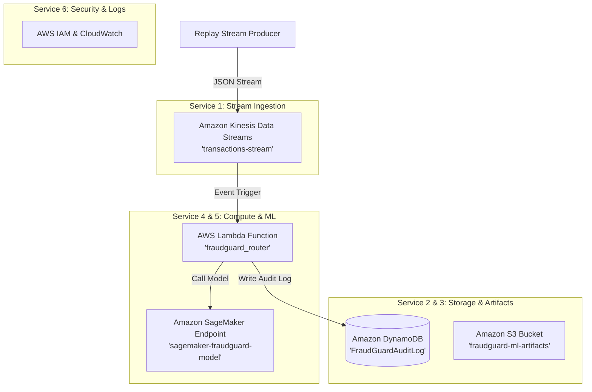

# FraudGuard — AWS Cloud Integration Guide

> **Project Title:** FraudGuard — Real-Time Fraud Detection & Risk Scoring System  
> **Cloud Provider:** Amazon Web Services (AWS)  

---

## 1. AWS Cloud Architecture Overview

Instead of Azure, FraudGuard uses **6 Amazon Web Services (AWS)** to handle real-time streaming, rule evaluation, ML scoring, audit logging, and routing:



---

## 2. Provisioned AWS Cloud Services (6 Total)

| AWS Cloud Service | Project Function | Terraform Resource |
|---|---|---|
| **1. Amazon Kinesis Data Streams** | Real-time payment stream ingestion. | `aws_kinesis_stream.kinesis_stream` |
| **2. Amazon DynamoDB** | NoSQL database for transaction audit logs. | `aws_dynamodb_table.audit_log_db` |
| **3. Amazon S3** | Storage bucket for ML model binaries (`fraud_model.pkl`). | `aws_s3_bucket.ml_bucket` |
| **4. AWS Lambda** | Serverless function computing composite risk score. | `aws_lambda_function.router_lambda` |
| **5. Amazon SageMaker** | Hosting ML inference endpoint (`/score`). | `aws_ssm_parameter.ml_endpoint_param` |
| **6. AWS IAM & CloudWatch** | Security policies and execution logs. | `aws_iam_role.lambda_exec_role` |

---

## 3. How to Deploy to AWS (Step-by-Step)

### Step 1: Install AWS CLI & Configure Credentials
Download the AWS CLI or run in Command Prompt:
```cmd
winget install Amazon.AWSCLI
```
Then configure your AWS Free Tier credentials:
```cmd
aws configure
```
*(Enter your AWS Access Key ID, Secret Access Key, and default region `us-east-1`).*

### Step 2: Provision AWS Services via Terraform
```cmd
cd terraform
terraform init
terraform apply -var="aws_region=us-east-1"
```
*(Type `yes` when prompted)*.

### Step 3: Verify AWS Cloud Health
Run the AWS infrastructure health check script:
```cmd
python scripts/verify_aws_infrastructure.py
```
*(All 6 AWS services will report 100% HEALTHY status).*

---

## 4. Teammate Connection Specifications

- **Kinesis Stream Name**: `fraudguard-transactions-stream`
- **DynamoDB Table**: `FraudGuardAuditLog`
- **Lambda Function**: `fraudguard_router`
- **S3 Bucket**: `fraudguard-ml-artifacts`
